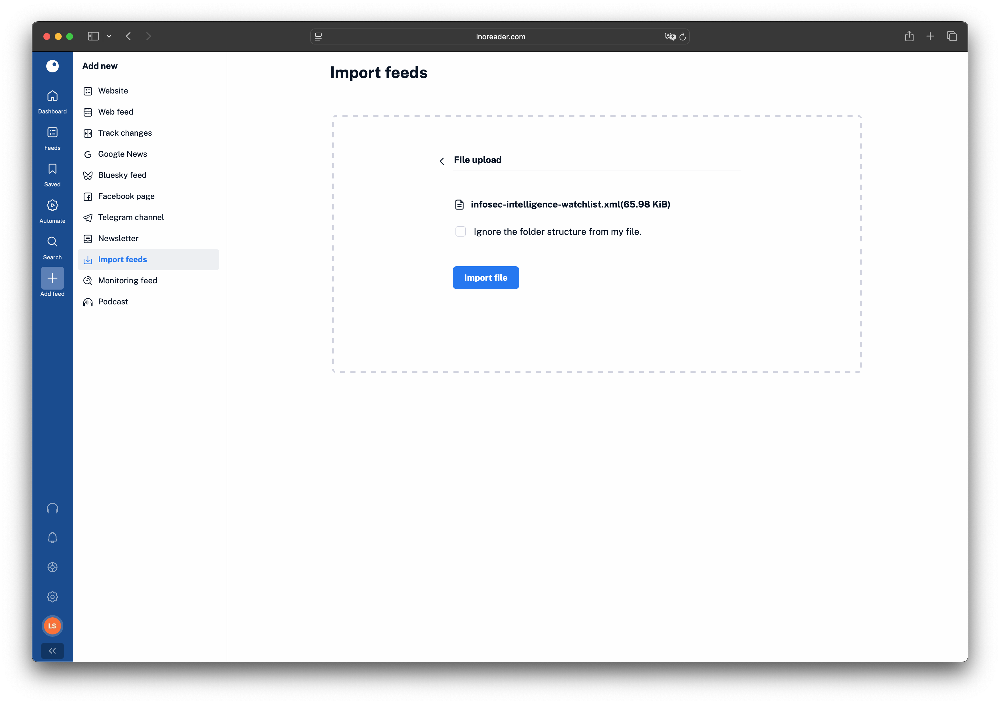
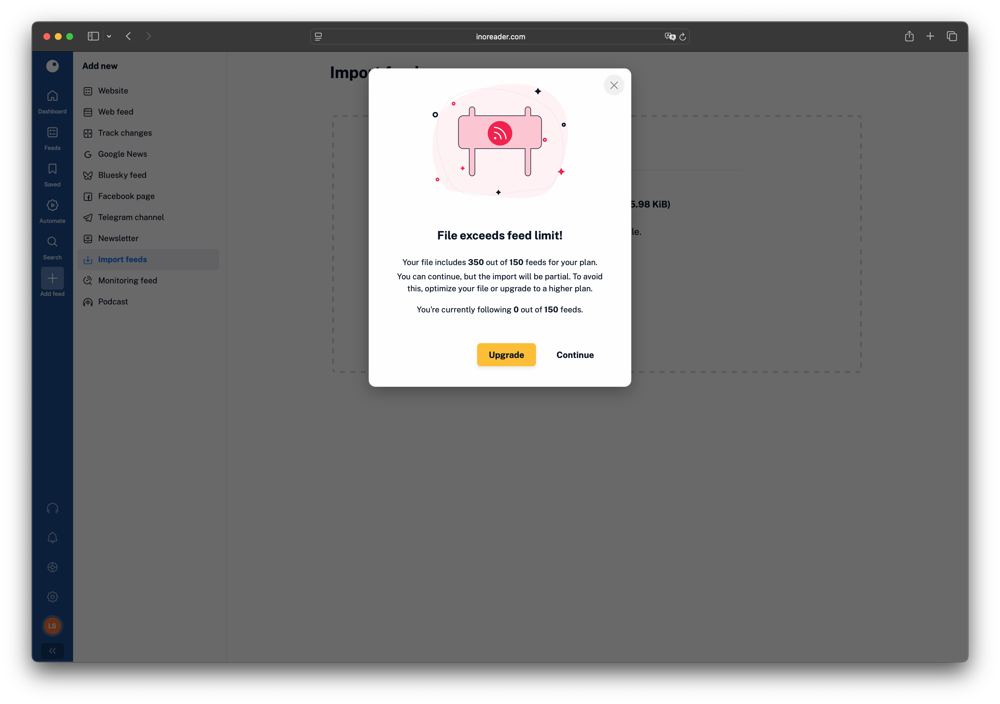
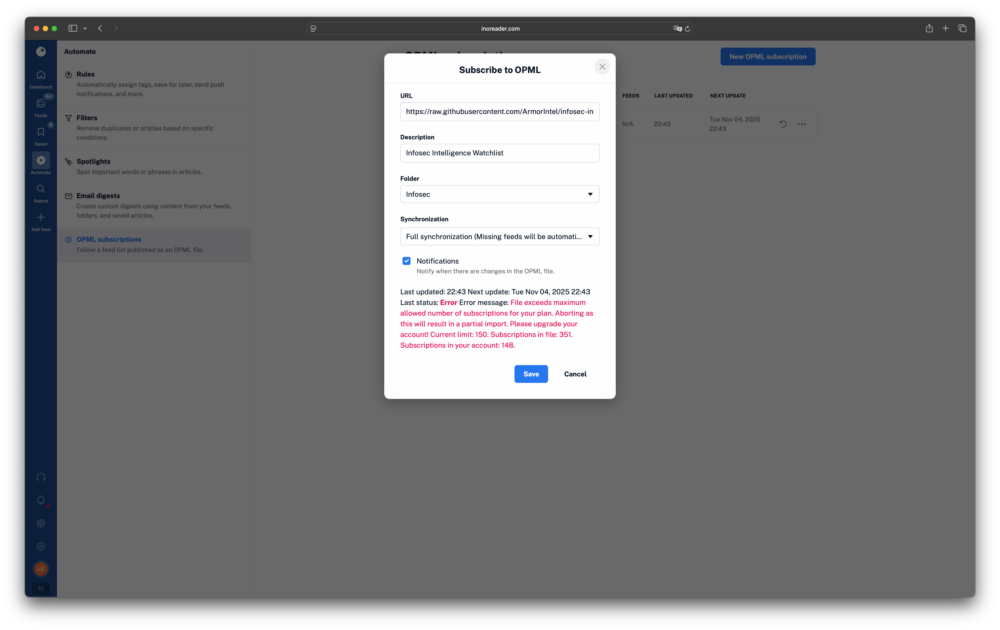
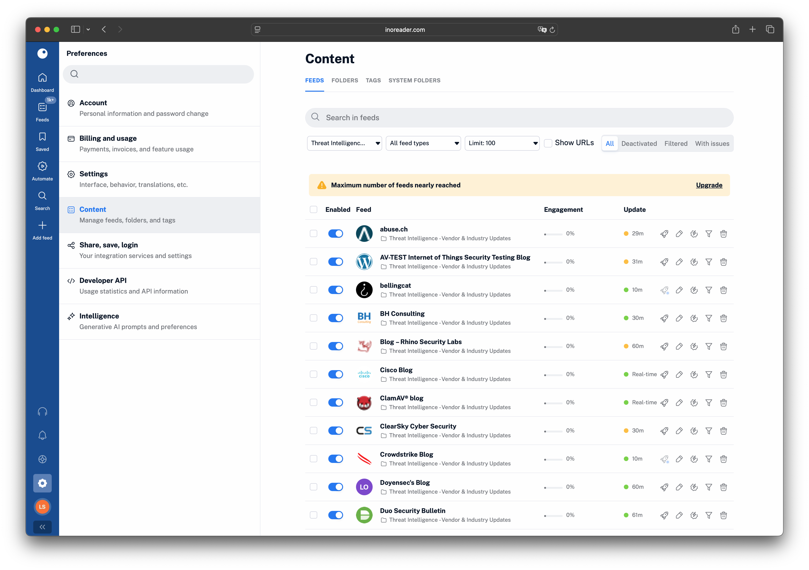
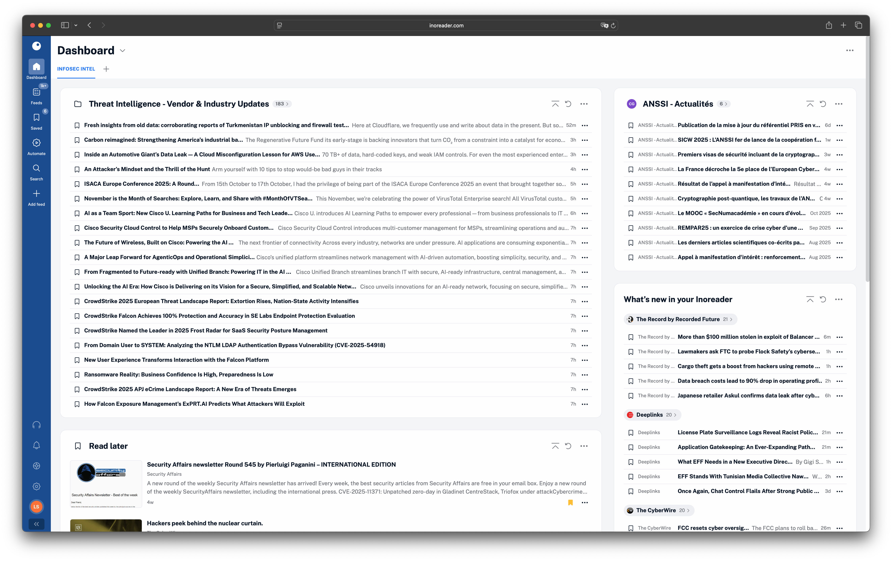

# Infosec Intelligence Watchlist

A maintained OPML list of RSS feeds for threat intelligence and technology monitoring, ready to import into your RSS reader.

- Sources are grouped by topic, from CERT bulletins and threat research to AI security and technology.
- Automated monthly health checks propose fixes for dead feeds and the removal of abandoned feeds, for human review.
- Explicit criteria require relevant, unique and active feeds, with exceptions for valuable sources that publish infrequently.
- Dated releases include OPML downloads and a summary of feeds added, removed and moved.
- The website shows recent articles, changes with their reasons, and a 90-day feed health history.

**[Browse the website](https://armorintel.github.io/infosec-intelligence-watchlist/)** — security and technology monitoring for security engineers, CTI/SOC analysts and CISOs, with your existing tools.

## Quick start

1. **Browse online:** use the [website](https://armorintel.github.io/infosec-intelligence-watchlist/) to read recent articles and pick individual feeds.
2. **Import everything:** download the [global OPML file](./infosec-intelligence-watchlist.xml) and import it into your RSS reader.
3. **Choose your topics:** import or [subscribe to a single category](#subscribe-to-a-single-category) using the table below.

## What's inside

<!-- BEGIN generated:categories -->
- `infosec-intelligence-watchlist.xml` &mdash; is an OPML (Outline Processor Markup Language) file of 295 feeds, grouped by categories:
  - **Threat Intelligence**
    - Security News
    - Research & Labs
    - AI Security
    - Vendor & Industry Updates
    - Government & CERT Bulletins
    - Alerts & Monitoring
    - Investigations & Breach Reporting
    - Communities & Experts
    - Knowledge Sharing & Podcasts
    - Intelligence Newsletters
    - OSINT & Tooling
  - **Technology Intelligence**
    - Industry & Innovation
    - AI & Data Science
    - Privacy, Compliance & Governance
    - Cryptocurrency & Blockchain
    - Apple Ecosystem
    - Hardware & IoT
    - Software & Open Source
    - Enterprise Platforms
    - Science & Academia
<!-- END generated:categories -->

## How to use

### Import the watchlist

Download the [global OPML file](./infosec-intelligence-watchlist.xml) and use your reader's OPML import option. The feeds are organized into categories and subcategories. The file works with any RSS reader that supports OPML imports. Review the folders and adjust notifications, filters, rules or tags to suit your needs.

### Subscribe to the OPML URL

An import adds the feeds once. To receive changes as sources are added, fixed or removed, subscribe to the raw OPML URL in a reader that supports OPML subscriptions:

```text
https://raw.githubusercontent.com/ArmorIntel/infosec-intelligence-watchlist/refs/heads/main/infosec-intelligence-watchlist.xml
```

Support for OPML subscriptions varies; check your reader's documentation.

### Subscribe to a single category

If you only need certain topics, or your reader's plan limits the number of feeds, import or subscribe to one or more category files instead. Each file contains one subcategory of the global watchlist and is updated along with it. Use the file link to download it, or copy its raw URL to subscribe.

<!-- BEGIN generated:category-table -->
| Category | Subcategory | Feeds | Raw OPML URL |
|---|---|---:|---|
| Threat Intelligence | [Security News](./opml/threat-intelligence/security-news.opml) | 21 | `https://raw.githubusercontent.com/ArmorIntel/infosec-intelligence-watchlist/refs/heads/main/opml/threat-intelligence/security-news.opml` |
| Threat Intelligence | [Research & Labs](./opml/threat-intelligence/research-and-labs.opml) | 36 | `https://raw.githubusercontent.com/ArmorIntel/infosec-intelligence-watchlist/refs/heads/main/opml/threat-intelligence/research-and-labs.opml` |
| Threat Intelligence | [AI Security](./opml/threat-intelligence/ai-security.opml) | 10 | `https://raw.githubusercontent.com/ArmorIntel/infosec-intelligence-watchlist/refs/heads/main/opml/threat-intelligence/ai-security.opml` |
| Threat Intelligence | [Vendor & Industry Updates](./opml/threat-intelligence/vendor-and-industry-updates.opml) | 30 | `https://raw.githubusercontent.com/ArmorIntel/infosec-intelligence-watchlist/refs/heads/main/opml/threat-intelligence/vendor-and-industry-updates.opml` |
| Threat Intelligence | [Government & CERT Bulletins](./opml/threat-intelligence/government-and-cert-bulletins.opml) | 22 | `https://raw.githubusercontent.com/ArmorIntel/infosec-intelligence-watchlist/refs/heads/main/opml/threat-intelligence/government-and-cert-bulletins.opml` |
| Threat Intelligence | [Alerts & Monitoring](./opml/threat-intelligence/alerts-and-monitoring.opml) | 11 | `https://raw.githubusercontent.com/ArmorIntel/infosec-intelligence-watchlist/refs/heads/main/opml/threat-intelligence/alerts-and-monitoring.opml` |
| Threat Intelligence | [Investigations & Breach Reporting](./opml/threat-intelligence/investigations-and-breach-reporting.opml) | 10 | `https://raw.githubusercontent.com/ArmorIntel/infosec-intelligence-watchlist/refs/heads/main/opml/threat-intelligence/investigations-and-breach-reporting.opml` |
| Threat Intelligence | [Communities & Experts](./opml/threat-intelligence/communities-and-experts.opml) | 25 | `https://raw.githubusercontent.com/ArmorIntel/infosec-intelligence-watchlist/refs/heads/main/opml/threat-intelligence/communities-and-experts.opml` |
| Threat Intelligence | [Knowledge Sharing & Podcasts](./opml/threat-intelligence/knowledge-sharing-and-podcasts.opml) | 3 | `https://raw.githubusercontent.com/ArmorIntel/infosec-intelligence-watchlist/refs/heads/main/opml/threat-intelligence/knowledge-sharing-and-podcasts.opml` |
| Threat Intelligence | [Intelligence Newsletters](./opml/threat-intelligence/intelligence-newsletters.opml) | 11 | `https://raw.githubusercontent.com/ArmorIntel/infosec-intelligence-watchlist/refs/heads/main/opml/threat-intelligence/intelligence-newsletters.opml` |
| Threat Intelligence | [OSINT & Tooling](./opml/threat-intelligence/osint-and-tooling.opml) | 8 | `https://raw.githubusercontent.com/ArmorIntel/infosec-intelligence-watchlist/refs/heads/main/opml/threat-intelligence/osint-and-tooling.opml` |
| Technology Intelligence | [Industry & Innovation](./opml/technology-intelligence/industry-and-innovation.opml) | 37 | `https://raw.githubusercontent.com/ArmorIntel/infosec-intelligence-watchlist/refs/heads/main/opml/technology-intelligence/industry-and-innovation.opml` |
| Technology Intelligence | [AI & Data Science](./opml/technology-intelligence/ai-and-data-science.opml) | 12 | `https://raw.githubusercontent.com/ArmorIntel/infosec-intelligence-watchlist/refs/heads/main/opml/technology-intelligence/ai-and-data-science.opml` |
| Technology Intelligence | [Privacy, Compliance & Governance](./opml/technology-intelligence/privacy-compliance-and-governance.opml) | 11 | `https://raw.githubusercontent.com/ArmorIntel/infosec-intelligence-watchlist/refs/heads/main/opml/technology-intelligence/privacy-compliance-and-governance.opml` |
| Technology Intelligence | [Cryptocurrency & Blockchain](./opml/technology-intelligence/cryptocurrency-and-blockchain.opml) | 15 | `https://raw.githubusercontent.com/ArmorIntel/infosec-intelligence-watchlist/refs/heads/main/opml/technology-intelligence/cryptocurrency-and-blockchain.opml` |
| Technology Intelligence | [Apple Ecosystem](./opml/technology-intelligence/apple-ecosystem.opml) | 10 | `https://raw.githubusercontent.com/ArmorIntel/infosec-intelligence-watchlist/refs/heads/main/opml/technology-intelligence/apple-ecosystem.opml` |
| Technology Intelligence | [Hardware & IoT](./opml/technology-intelligence/hardware-and-iot.opml) | 5 | `https://raw.githubusercontent.com/ArmorIntel/infosec-intelligence-watchlist/refs/heads/main/opml/technology-intelligence/hardware-and-iot.opml` |
| Technology Intelligence | [Software & Open Source](./opml/technology-intelligence/software-and-open-source.opml) | 10 | `https://raw.githubusercontent.com/ArmorIntel/infosec-intelligence-watchlist/refs/heads/main/opml/technology-intelligence/software-and-open-source.opml` |
| Technology Intelligence | [Enterprise Platforms](./opml/technology-intelligence/enterprise-platforms.opml) | 5 | `https://raw.githubusercontent.com/ArmorIntel/infosec-intelligence-watchlist/refs/heads/main/opml/technology-intelligence/enterprise-platforms.opml` |
| Technology Intelligence | [Science & Academia](./opml/technology-intelligence/science-and-academia.opml) | 3 | `https://raw.githubusercontent.com/ArmorIntel/infosec-intelligence-watchlist/refs/heads/main/opml/technology-intelligence/science-and-academia.opml` |
<!-- END generated:category-table -->

### Inoreader example

#### Import feeds

Import the feeds once:



Inoreader plan limits may restrict how many feeds you can add.



Alternatively, subscribe to the raw OPML URL [above](#subscribe-to-the-opml-url) to receive list updates:



#### Explore feeds


#### Manage feeds



#### Create custom dashboards



**Pro tips:** use tags, filters and automated rules to organize your monitoring. Inoreader also supports Telegram channel subscriptions, an API and an n8n integration for further automation. Some features require a paid plan.

## How the list is kept healthy

The list is reviewed periodically to add relevant sources and replace or remove feeds that no longer work. New feeds must be unique, relevant to security or technology monitoring, and placed in the most appropriate subcategory. Personal RSS account entries, such as keyword alerts and newsletter addresses, are excluded.

Review criteria:

- **Dead feed:** fails twice in a row because of a DNS error, HTTP 404/410/5xx, timeout, invalid certificate or invalid RSS/Atom document. If the source has moved, update its feed URL rather than remove it.
- **Inactive feed:** nothing published for more than 6 months.
- **Abandoned feed:** nothing published for more than 24 months; removed even if previously exempted.
- **Exceptions:** sources that publish infrequently but remain valuable (CERTs, government agencies, research labs, recognized researchers and primary sources) are kept if they have published within the last 24 months.
- **Reader compatibility:** feeds blocked by anti-bot protection (HTTP 403/429 to scripts) but working in RSS readers are kept.

An automated check runs on the first day of each month. It proposes replacement URLs and removes abandoned feeds in a pull request for review, while a single health issue tracks anything that still needs attention. Persistent failures are reported after 3 months; temporary failures remain under watch. New feeds added through pull requests are checked for availability, valid RSS/Atom and publication within the last 6 months.

The website rebuilds every 6 hours and shows recent articles, a Changes page with the reason for each change, and a Health page with 90 days of history. Collection issues on the build server are distinguished from feed failures. Reviewed watchlists can be published as dated releases with OPML files and change notes.

Last review: **October 2026**.

## Contributing

Contributions are welcome.

### Suggest a source

The easiest way: [suggest a source](https://github.com/ArmorIntel/infosec-intelligence-watchlist/issues/new?template=suggest-feed.yml) (also linked at the bottom of every page of the website). Paste a link to one of its articles; there is no need to find the RSS feed. The link is checked automatically and the issue is answered within minutes. For a new valid feed, a pull request adding it is prepared for review. Every suggestion is reviewed before being added.

### Edit the watchlist yourself

To add feeds or suggest improvements with a pull request:

- Fork this repository
- Update `infosec-intelligence-watchlist.xml`, the source file for the watchlist: keep two folder levels and feeds sorted alphabetically
- Don't edit the `opml/` files or the generated parts of this README by hand: regenerate them with `python3 scripts/build_category_opml.py --readme` and commit the result with your change (the pull request check fails when they are out of date)
- For a new feed, also add its English and French descriptions to `site/descriptions.json` (the website build lists the feeds that are missing)
- In the commit message, add one line per feed giving the reason for each feed you add, remove, move or fix: `- <feed URL>: <reason>` (e.g. `- https://example.com/feed: dead feed, replaced by https://example.com/rss`). The website's Changes page shows it next to the change; without one, it shows the commit's subject line
- Submit a pull request with a description

Maintained by [ArmorIntel](https://github.com/ArmorIntel/).
You can contact [ArmorIntel](https://github.com/ArmorIntel/) for collaboration or CTI discussions.

## For maintainers

### Repository contents

- `infosec-intelligence-watchlist.xml` — the global source file; category OPML files and README blocks are generated from it.
- `opml/` &mdash; one OPML file per subcategory, generated from the global file, to subscribe only to the topics you need (see [Subscribe to a single category](#subscribe-to-a-single-category))
- `scripts/` &mdash; maintenance scripts used by the GitHub Actions (see [Automation](#automation)):
  - `bot_pr.py` &mdash; opens, updates or closes bot pull requests, preserving branches with human commits
  - `build_category_opml.py` &mdash; regenerates the `opml/` files and the generated parts of this README
  - `check_feeds.py` &mdash; checks the health of every feed (dead, inactive, unreachable), with a month-by-month history
  - `autofix_feeds.py` &mdash; finds replacement URLs for dead feeds and removes abandoned ones
  - `feed-exceptions.txt` &mdash; low-frequency, high-value sources and known quirks the health check should not flag
  - `validate_opml.py` &mdash; validates the OPML structure (two folder levels, no duplicates, sorted feeds)
  - `changelog.py` &mdash; lists the feeds added, removed and moved between two versions
  - `build_site.py` &mdash; builds the static website (English and French) from the watchlist and the latest articles from its feeds
  - `feed_items.py` &mdash; fetches and parses the latest articles of a feed (RSS/Atom) for the website
  - `site_data.py` &mdash; loads the watchlist and the feed descriptions, merges feed state with the previous build and selects recent news
  - `site_changes.py` &mdash; lists the feed changes and their reasons from the git history, for the website's Changes page
  - `site_health.py` &mdash; keeps the 90-day health history of every feed, for the website's Health page and its "Unstable" badges
  - `site_render.py` &mdash; renders the website pages from the data
  - `suggest_feed.py` &mdash; finds and checks the feed of a source suggested by a visitor, and writes the answer to post on the issue
  - `suggest_pr.py` &mdash; adds a suggested feed to the watchlist and writes its pull request
  - `suggest_ai.py` &mdash; asks an AI (any OpenAI-compatible API) for the subcategory and descriptions of a suggested feed
- `site/` &mdash; website content: `descriptions.json` (a short English and French description for every feed), `strings.json` (interface texts) and `static/` (styles and scripts)
- `tests/` &mdash; unit tests of the scripts (`python3 -m unittest discover -s tests`)

### Automation

The repository is maintained with GitHub Actions:

| Workflow | Trigger | What it does |
|---|---|---|
| [Monthly feed health check](.github/workflows/feed-health.yml) | 1st of each month, or manually | Checks every feed, opens a pull request with automatic fixes (replacement URLs on the same website for dead feeds; removal of abandoned feeds) and keeps a single [`feed-health`](https://github.com/ArmorIntel/infosec-intelligence-watchlist/issues?q=label%3Afeed-health) issue with what is left to review |
| [Validate watchlist](.github/workflows/validate-pr.yml) | Every pull request (full checks for changes to the watchlist, README, generated files, scripts, site, tests or validation workflow), pushes to `main` changing the watchlist, or manually | Runs the unit tests, validates the OPML structure, rejects duplicates, checks that the per-category OPML files and the generated parts of this README are up to date, and checks that every added feed responds, is valid RSS/Atom and has published within the last 6 months |
| [Sync generated files](.github/workflows/sync-generated.yml) | Pushes to `main` changing the watchlist or its category generator, or manually | Safety net: regenerates the per-category OPML files and the generated parts of this README (category list, feed count, subscription table) and, if they were out of date, opens a `sync/generated-files` pull request (`main` accepts only pull requests, which include these regenerated files) |
| [Publish the website](.github/workflows/site.yml) | Every 6 hours, pushes to `main` changing the watchlist, the site or its scripts, or manually | Runs the unit tests, builds the website with the latest articles from every feed (a feed that fails keeps its articles from the previous version), adds the result of every feed to its 90-day health history, and deploys it to GitHub Pages |
| [Feed suggestion](.github/workflows/suggest-feed.yml) | Suggestion issue opened, edited or labeled `feed-suggestion`, or manually | Finds the site's feed from the submitted link, checks it (new, valid, active) and answers on the issue with a comment and a [`suggestion: …`](https://github.com/ArmorIntel/infosec-intelligence-watchlist/labels) status label. Suggestions for already-listed sources are closed. For a new valid feed, opens a pull request adding it, with the subcategory and English/French descriptions proposed by an AI, to review |
| [Release a reviewed watchlist](.github/workflows/release.yml) | Manually, after a review | Creates a dated release (e.g. `2026.10`) with the list of feeds added, removed and moved since the previous one, and the OPML files as attachments |

### Monthly checks and health history

- **History**: each feed's status is kept month by month on the `feed-health-history` branch. A dead or unreachable feed is only reported after failing **3 months in a row**; until then it is listed as "under watch" in a collapsed section. Temporary outages and anti-bot blocks affecting GitHub servers therefore require no action
- **Automatic fixes**: for a dead feed, or one unreachable for 3 months, the workflow looks for a replacement on the same website (feed autodiscovery links, then common feed paths) and keeps it only if it is a valid feed that has published within the last 6 months. Abandoned feeds (nothing for 24 months) are removed. The fixes are proposed in a single `feed-health/autofix` pull request for review and merging
- **Health history**: the website's Health page shows, for every feed and every day of the last 90, whether it worked, failed, went inactive (published nothing for 6 months) or only had a collection issue (blocked or unreadable for the GitHub runner, usually fine in readers, not counted against the feed). Feeds that worked on fewer than 80% of the days checked in the last 30 days get an "Unstable" badge in the catalogue. The history is stored in the published `data.json` and starts with the first deploy
- **Merging the fix pull request**: use a merge commit (or keep the commit body when squashing), so the per-feed `- <feed URL>: <reason>` lines reach the website's Changes page
- **Exceptions**: feeds that work in RSS readers but not for the checker, or approved low-frequency, high-value sources, go in [`scripts/feed-exceptions.txt`](scripts/feed-exceptions.txt) and are never flagged again (unless abandoned)
- The issue is closed automatically once nothing is left to review

### GitHub settings

AI setup for feed suggestions: create a Gemini API key in Google AI Studio, add it as the `AI_API_KEY` repository secret, and set the `AI_MODEL` repository variable to a model available on your plan. To use another provider (e.g. OpenRouter), also set the `AI_API_URL` variable to its OpenAI-compatible chat completions URL. Without a key or a model, suggestion pull requests open without descriptions, with feeds placed in Security News. GitHub holds the required `validate` check on these bot pull requests until you click *Approve workflows to run* on the pull request.

For the workflow to open the fix pull request itself, enable *Settings > Actions > General > Allow GitHub Actions to create and approve pull requests*. Otherwise the issue links to the branch so the pull request can be opened in one click.

One-time setup for the website: enable *Settings > Pages > Source: GitHub Actions*, then run the workflow once manually. GitHub disables scheduled workflows after 60 days without repository activity; if the website stops updating, open the *Actions* tab, select the workflow and click *Enable workflow*.

### Run locally

To run the checks locally (Python 3.10+ and curl, no third-party Python dependencies):

```bash
python3 scripts/validate_opml.py
python3 scripts/check_feeds.py --markdown report.md
```
